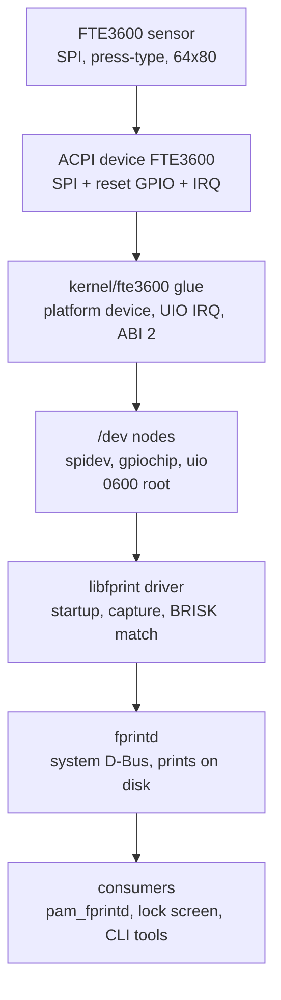

# Architecture

Six layers, each one replaceable on its own. Only the kernel glue and the
libfprint driver are specific to this project; everything above them is stock.



## 1. Sensor and ACPI

The sensor is a capacitive **press-type** reader: one image per touch, no swipe
strip. The FW9369 firmware produces a 64x80 grayscale image. Wiring is described
by ACPI, not by laptop model:

* one four-wire SPI connection,
* one reset GPIO,
* one edge-triggered interrupt.

```sh
ls /sys/bus/acpi/devices | grep FTE3600        # FTE3600:00
cat /sys/bus/acpi/devices/FTE3600:00/status    # 15 = present, enabled
```

Never guess pins or firmware from the ACPI name alone; different panels reuse
the same name with different chips.

## 2. Kernel glue (`kernel/fte3600`)

The module (`fte3600`, DKMS package 0.2, glue ABI 2) pairs the distribution
`spidev` with a reset line and an IRQ-only UIO device. It performs **no SPI transfers** and
does not replace the SPI controller.

| Attribute | Measured on the validated machine |
| --- | --- |
| `fte3600_glue_abi` | `2` |
| `fte3600_ngpio` | `1` (offset 0, `reset`) |
| `fte3600_status` | `ready` |
| `fte3600_generation` | session generation, bumped when a session is torn down |
| `fte3600_acpi_mode` | `0` |
| `fte3600_cs_control` | `1` |
| `fte3600_acpi_speed_hz` | `1000000` |
| `fte3600_irq_active_low` | `0` |
| `fte3600_irq_source` | `gpio` |

```sh
cat /sys/bus/platform/devices/fte3600-glue.*/fte3600_status
cat /sys/class/uio/uio0/name /sys/class/uio/uio0/version   # fte3600-irq 2
```

The values above describe one machine. A different panel legitimately reports
different mode, polarity or speed; read them, never hardcode them.

## 3. Device nodes

The glue creates stable symlinks and the distribution's spidev/gpio/uio drivers
provide the targets:

```sh
ls -l /dev/fte3600-*
# /dev/fte3600-spi-FTE3600:00  -> spidev1.0
# /dev/fte3600-gpio-FTE3600:00 -> gpiochip1
# /dev/fte3600-irq-FTE3600:00  -> uio0
cat /sys/module/spidev/parameters/bufsiz     # must be >= 65536
```

All targets are `0600 root:root`. No user session can open them; every
consumer reaches the sensor through fprintd, which runs as root. This is why
the toolbox talks D-Bus instead of touching `/dev`.

## 4. libfprint driver (`libfprint/drivers/fte3600`)

Responsibilities:

* **startup** — reset, firmware handshake, calibration with the sensor
  uncovered; a resting finger or a lost FW9369 session makes that attempt fail,
  so the driver reports a retryable error and reopens once (bounded to two);
* **capture** — one press, quality checks, a lost session surfaces as retryable
  rather than as a user error;
* **features** — BRISK keypoints and descriptors on the 64x80 image;
* **template** — eight feature sets, each new sample must already match an
  accepted one, and an identical image or feature set is rejected as a
  duplicate (`FTE3600_AUTH_ENROLL_SAMPLES`);
* **match** — probe against all eight samples, best accepted result wins;
* **identify** — same comparison across every print in the gallery.

Acceptance is a set of gates, not a score: mutual matches, inlier count, inlier
ratio, margin over the runner-up, median and RMS error, plus variance and
anisotropy checks. `FTE3600_BRISK_THRESHOLDS_CALIBRATED` is still `0`: the
constants were chosen from a small sample and are **not** population
calibrated. That is the source of the intermittent false rejects.

```sh
grep -rn "FTE3600_AUTH_ENROLL_SAMPLES\|THRESHOLDS_CALIBRATED" \
  libfprint/drivers/fte3600/include libfprint/drivers/fte3600/sam7-brisk/libfprint/drivers
```

The driver implements `.suspend` and `.resume` for `VERIFY` and `IDENTIFY`:
when the system suspends mid-scan (for example, closing the lid while the lock
screen is active), the worker cleanly closes the hardware handle and pauses the
action, then reopens the sensor on resume. `ENROLL` and `CAPTURE` fall back to
framework cancellation. See
[troubleshooting](troubleshooting.md#cannot-run-while-suspended).

## 5. fprintd

`fprintd` owns the device, exposes one object per reader on the system bus and
stores prints through libfprint's print storage. Access is serialized by
`Claim`, so two clients cannot capture at the same time.

```sh
gdbus introspect --system -d net.reactivated.Fprint \
  -o /net/reactivated/Fprint/Device/0
```

`VerifyStart("any")` — what PAM always sends — means:

| Enrolled prints for the user | Behaviour |
| --- | --- |
| 0 | error `No fingerprints enrolled` |
| 1 | verify that single print |
| 2 or more, driver has IDENTIFY | **identify** across the whole gallery |

Enrolling the same finger under a second finger name therefore raises the
chance of a hit without touching the driver.

`num-enroll-stages` reads `9` for this driver: eight samples plus one extra
stage that fprintd adds for its own duplicate identification. Do not hardcode
it; read the property.

## 6. Consumers

* `pam_fprintd` in `/usr/lib/pam.d/kde-fingerprint` (lock screen) and in
  `/etc/pam.d/sudo` where the administrator added it. PAM asks for `any`;
  with several prints that becomes an identification.
* Desktop tools (`fprintd-enroll`, `fprintd-verify`, the toolbox) use the same
  D-Bus API as PAM, so anything they can do, PAM can do.
* Password authentication is never removed by this project.

## Measured timing

All figures below are from the validated machine; treat them as shape, not
constants.

| Step | Measured |
| --- | --- |
| `Claim` (device wake-up and open) | 3.9-4.5 s |
| capture timeout when no finger arrives | ~30 s after `Verify started` |
| full round with no finger | ~34 s including `Claim` |
| enrollment | 8 accepted samples, retries in between are normal |

Consequence for any user interface: presses made during the `Claim` window are
lost. Announce "press now" only after `VerifyStart` has returned.

Reproduce the `Claim` cost — the gap between the first two lines is the device
open, everything after `Verify started` is capture:

```sh
fprintd-verify -f right-index-finger "$USER" | while IFS= read -r l; do
  printf '%s %s\n' "$(date +%H:%M:%S.%3N)" "$l"
done
```

## Out of scope

* USB sensors and the older private `/dev/fte3600-*` bridge ABI.
* Suspend/resume during active enrollment or raw image capture (those cancel
  safely; `VERIFY` and `IDENTIFY` pause and resume automatically).
* Firmware redistribution; payloads are supplied by the user.
* Status LED or buzzer. The sensor gives no feedback, which is exactly why the
  [toolbox](toolkit.md) exists.
